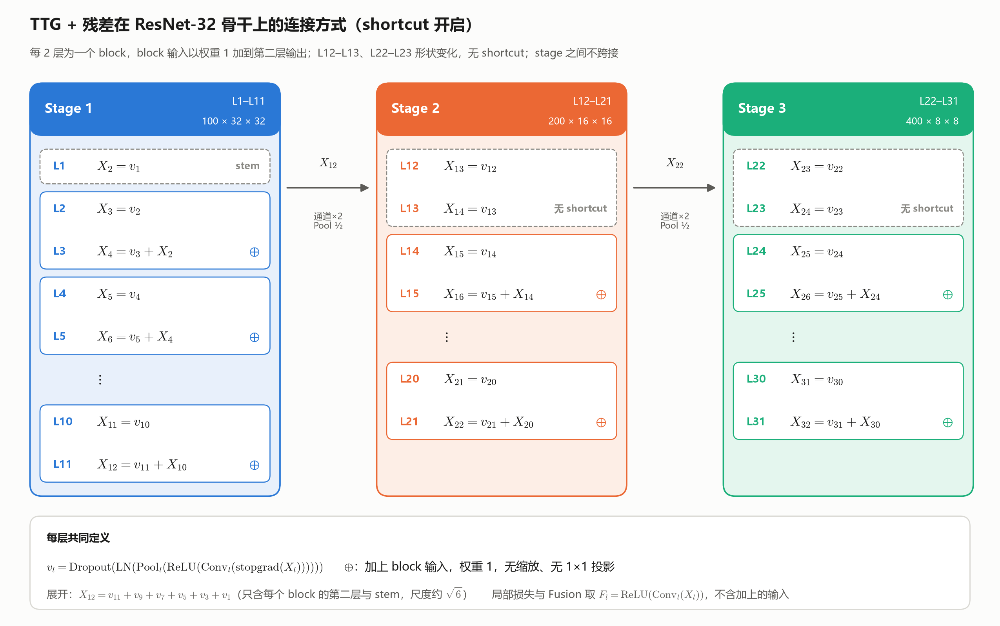
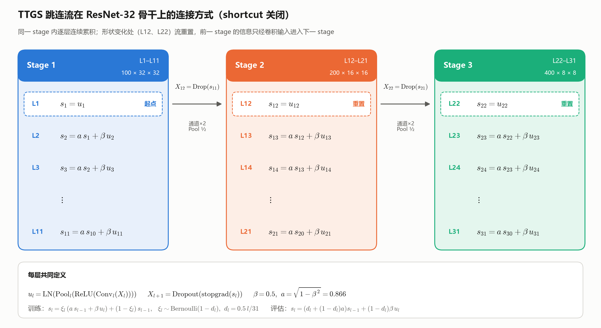

# FF 研究共识

## 共识一：训练平台与公平比较

### 训练定义与平台

FF 训练不依赖全局 BP，允许当前学习单元内部使用局部反向传播。

```text
输入特征 → 卷积 → ReLU
                  ├→ [FF训练设计] → 更新当前学习单元
                  └→ Pool → Dropout → Norm → detach → 下一层
```

Pool、Dropout、Norm 的形式与参数允许根据 FF 训练设计适配。

优化器及学习率设置允许按 FF 方法选择。

batch_size 由设备容量决定，在设备上确认可运行后固定，同一数据集各方法相同，并保存到实验配置中，不根据测试成绩选择。

### 控制变量

- 同一数据集内，各方法使用相同的卷积骨干。
- 固定卷积层数、通道数、kernel size、stride、padding、dilation、groups 和 bias 配置。
- 统一初始化规则，同一种子下尽可能使用相同初始卷积权重；训练后的权重由各方法自行学习。
- 不同数据集可以采用各自预先确定的卷积骨干。
- 自研方法涉及配置搜索时采用可比的搜索空间和预算。

### 数据集

- **CIFAR-10**：初步验证与消融。
- **CIFAR-100**：考察类别增加后的表现。
- **Tiny-ImageNet**：考察更高分辨率、更多类别下的表现。
- **ImageNet**：考察大规模数据集下的表现。

### 评估原则

以下最优配置表达式用于自研 FF 方法的研究。

在固定数据集 \(D\) 和卷积骨干 \(B\) 下，比较各 FF 方法经过配套配置适配后的准确率。

\[
c=(\mathrm{Pool},\mathrm{Dropout},\mathrm{Norm},\mathrm{Optimizer},\mathrm{LR\ settings})
\]

\[
c_M^*=\arg\max_{c\in\mathcal C}\mathrm{Acc}_{val}(M,D,B,c)
\]

\[
\mathrm{Score}(M;D,B)=\mathrm{Acc}_{test}(M,D,B,c_M^*)
\]

自研方法进行配置搜索时，在验证集上选择配置，在测试集上报告结果。计算成本、显存和训练速度另行记录。

## 共识二：统一实验条件

### 共同卷积结构

| 数据集 | 输入尺寸 | 逐层输出通道数 |
|---|---|---|
| CIFAR-10 | 32×32 | `[100,100,200,200,400,400,400,400]` |
| CIFAR-100 | 32×32 | `[100,100,200,200,400,400,400,400]` |
| CIFAR-100（16 层） | 32×32 | `[100,100,100,100,200,200,200,200,400,400,400,400,400,400,400,400]` |
| Tiny-ImageNet | 64×64 | `[200,200,200,200,400,400,400,400]` |

共 8 个 Conv（CIFAR-100 另设 16 层骨干：8 层配置每项重复一次，Pool 位置对应后移，用 `--depth 16` 选择），每层后接 ReLU；统一 `kernel_size=3`、`stride=1`、`padding=1`、`dilation=1`、`groups=1`、`bias=True`。Pool、Dropout、Norm 按共识一适配，不改变共同 Conv 配置。方法可在层间传递中加入无参数的同形状跳连（如 TTGS），梯度仍在层内截断，不改变共同 Conv 配置。

### 数据划分与增强

- CIFAR-10／100 使用官方 50,000 张训练集和 10,000 张测试集；Tiny-ImageNet 使用官方 100,000 张训练集和 10,000 张验证集，不使用无公开标签的测试集。均不另划数据集，不用评估集调参。
- 训练使用 `RandomCrop`、`RandomHorizontalFlip(p=0.5)`、`ToTensor`、`Normalize`；CIFAR 的裁剪尺寸／padding 为 32／4，Tiny-ImageNet 为 64／8。
- 评估仅使用 `ToTensor` 和与训练相同的 `Normalize`；图片统一为 RGB，归一化统计量仅从训练集计算并保存。同一数据集的所有方法使用相同的数据增强与输入标准化设置。

### 不做调参的复现原则

- 共同骨干与统一实验条件之外，按论文或作者代码设置；未指定的使用默认值。
- 不做调参搜索，不根据评估成绩修改配置，不为低分追加优化或解释。
- 负责实现正确、执行统一实验，不负责让每个算法表现好。

## 共识三：统一多层融合评估

### 评估指标

- **Unified Fusion**：用统一的轻量线性分类器融合多层特征，衡量各 FF 方法学到的多层特征在相同读出条件下的分类能力，作为综合正确率。
- **Best Pred**：各层局部预测正确率的最大值，同时记录层号，衡量最好的单层预测能力；不包含 Fusion。
- 两者互补，不将逐层正确率的平均值作为综合正确率，也不将 Fusion 分数视为算法全部优劣的度量。

### Unified Fusion

```text
各层 Conv → ReLU 特征
             ├→ 原方法局部训练与层间传递
             └→ detach → GAP → 多层拼接 → 统一线性分类器
                                              ↓
                                           交叉熵
                                              ↓
                                      仅更新 Fusion 参数
```

\[
F_l=\operatorname{ReLU}(\operatorname{Conv}_l(X_l)),\qquad
z_{\mathrm{fusion}}=W\operatorname{Concat}_{l\in S}
\left[\operatorname{GAP}(\operatorname{detach}(F_l))\right]+b
\]
\[
\mathcal L_{\mathrm{fusion}}=\operatorname{CE}(z_{\mathrm{fusion}},y),\qquad
\hat y=\arg\max_k z_{\mathrm{fusion},k}
\]

- 统一从 ReLU 后、方法专属 Pool／Dropout／Norm 前取特征，避免不同归一化方式移除不同分类信息。
- 同一数据集内，统一纳入层集合 \(S\)、特征提取位置、分类器结构、初始化、优化器与学习率配置；实验前固定，不按方法或测试成绩选择。纳入全部层（8 层或 16 层），GAP 拼接后使用一个线性分类器；Kaiming normal、零偏置，AdamW（betas=0.9／0.999，eps=1e-8，weight_decay=0.001），学习率 0.0002 余弦衰减至 0.00001，与骨干同步训练至最后一轮。
- 每个 batch 复用已有卷积特征，更新一次 Fusion；不回传骨干、不为 Fusion 训练增加卷积前向或额外遍历数据集，也不在 epoch 后或训练结束后追加 Fusion 训练。
- Fusion 的参数量、训练耗时和显存纳入实验成本。它是在线训练的公共评估头，不是训练结束后另行拟合的线性探针。
- 各算法局部训练规则保持不变；公共 Fusion 与原论文预测器不同之处明确区分，不混用名称或结果。

### 逐层统计与 Best Pred

\[
A_l=\frac{1}{N}\sum_{n=1}^{N}\mathbf 1[\hat y_l(x_n)=y_n],\qquad
A_{\mathrm{best}}=\max_l A_l,\qquad
l_{\mathrm{best}}=\arg\max_l A_l
\]

- 每个 epoch 累计所有训练样本的 Fusion 与逐层正确数，轮末统一计算正确率及 Best Pred；不逐 batch 取最大后平均，不按样本挑选正确的层。
- 训练正确率复用训练时已有输出，反映整轮在线训练过程，不重新进行轮末冻结模型评估。统计不参与梯度更新。
- 逐层预测均按数据集原始类别标签计算；粗类别正确率不得与细类别正确率混合取最大值。
- 正式训练每轮结束后，以 `eval()` 和无梯度模式遍历上述官方 10,000 张评估图片一次，同时统计 Fusion、逐层正确率与 Best Pred，不更新任何参数。最终成绩取最后一轮的最终模型，不选择最佳 checkpoint，不取曲线最高点；评估 Best Pred 仅为层间最高分统计，不用于选择模型或替代 Fusion 主指标。
- 每轮记录 `train/fusion_accuracy`、`train/layer_{i}_accuracy`、`train/best_pred_accuracy`、`train/best_pred_layer` 及对应 `test/` 字段，层号从 1 开始；W&B 曲线统一以 `epoch` 为横轴。评估耗时与峰值显存单独记录，不计入训练耗时。

### Global BP 对照

- Global BP 复用共同八层 CNN 与多层 Fusion，移除 detach，由单个 Fusion 交叉熵端到端更新全部卷积及分类头；无局部分类器，不记录逐层准确率或 Best Pred。
- 沿用 ASGE 的 RMS Pool、Dropout=0.1、RMSNorm、初始化及数据处理；AdamW，学习率 `2e-4` 余弦降至 `1e-5`，weight_decay=`1e-3`，其余参数不变。
- 最终成绩取最后一轮 `test/fusion_accuracy`。BP 是端到端对照，不属于 FF；FF 的梯度隔离规则保持不变。

## 共识四：ResNet-32 网络结构

| Layer | Stage | Input ($C\times H\times W$) | Conv ($k$, $s$, $p$) | Conv output | Pool | Output to next layer | Shortcut | Goodness dim | Params | MACs |
|---|---|---|---|---|---|---|---|---|---|---|
| L1 | Stem | 3×32×32 | 3×3, 1, 1 | 100×32×32 | — | 100×32×32 | — | 1600 | 2,800 | 2.76M |
| | | | | | | | | | | |
| L2 | 1 | 100×32×32 | 3×3, 1, 1 | 100×32×32 | — | 100×32×32 |  | 1600 | 90,100 | 92.16M |
| L3 | 1 | 100×32×32 | 3×3, 1, 1 | 100×32×32 | — | 100×32×32 | ⊕ L2 input | 1600 | 90,100 | 92.16M |
| | | | | | | | | | | |
| L4 | 1 | 100×32×32 | 3×3, 1, 1 | 100×32×32 | — | 100×32×32 |  | 1600 | 90,100 | 92.16M |
| L5 | 1 | 100×32×32 | 3×3, 1, 1 | 100×32×32 | — | 100×32×32 | ⊕ L4 input | 1600 | 90,100 | 92.16M |
| | | | | | | | | | | |
| L6 | 1 | 100×32×32 | 3×3, 1, 1 | 100×32×32 | — | 100×32×32 |  | 1600 | 90,100 | 92.16M |
| L7 | 1 | 100×32×32 | 3×3, 1, 1 | 100×32×32 | — | 100×32×32 | ⊕ L6 input | 1600 | 90,100 | 92.16M |
| | | | | | | | | | | |
| L8 | 1 | 100×32×32 | 3×3, 1, 1 | 100×32×32 | — | 100×32×32 |  | 1600 | 90,100 | 92.16M |
| L9 | 1 | 100×32×32 | 3×3, 1, 1 | 100×32×32 | — | 100×32×32 | ⊕ L8 input | 1600 | 90,100 | 92.16M |
| | | | | | | | | | | |
| L10 | 1 | 100×32×32 | 3×3, 1, 1 | 100×32×32 | — | 100×32×32 |  | 1600 | 90,100 | 92.16M |
| L11 | 1 | 100×32×32 | 3×3, 1, 1 | 100×32×32 | — | 100×32×32 | ⊕ L10 input | 1600 | 90,100 | 92.16M |
| | | | | | | | | | | |
| L12 | 2 | 100×32×32 | 3×3, 1, 1 | 200×32×32 | 2×2, 2 | 200×16×16 |  | 800 | 180,200 | 184.32M |
| L13 | 2 | 200×16×16 | 3×3, 1, 1 | 200×16×16 | — | 200×16×16 | none | 800 | 360,200 | 92.16M |
| | | | | | | | | | | |
| L14 | 2 | 200×16×16 | 3×3, 1, 1 | 200×16×16 | — | 200×16×16 |  | 800 | 360,200 | 92.16M |
| L15 | 2 | 200×16×16 | 3×3, 1, 1 | 200×16×16 | — | 200×16×16 | ⊕ L14 input | 800 | 360,200 | 92.16M |
| | | | | | | | | | | |
| L16 | 2 | 200×16×16 | 3×3, 1, 1 | 200×16×16 | — | 200×16×16 |  | 800 | 360,200 | 92.16M |
| L17 | 2 | 200×16×16 | 3×3, 1, 1 | 200×16×16 | — | 200×16×16 | ⊕ L16 input | 800 | 360,200 | 92.16M |
| | | | | | | | | | | |
| L18 | 2 | 200×16×16 | 3×3, 1, 1 | 200×16×16 | — | 200×16×16 |  | 800 | 360,200 | 92.16M |
| L19 | 2 | 200×16×16 | 3×3, 1, 1 | 200×16×16 | — | 200×16×16 | ⊕ L18 input | 800 | 360,200 | 92.16M |
| | | | | | | | | | | |
| L20 | 2 | 200×16×16 | 3×3, 1, 1 | 200×16×16 | — | 200×16×16 |  | 800 | 360,200 | 92.16M |
| L21 | 2 | 200×16×16 | 3×3, 1, 1 | 200×16×16 | — | 200×16×16 | ⊕ L20 input | 800 | 360,200 | 92.16M |
| | | | | | | | | | | |
| L22 | 3 | 200×16×16 | 3×3, 1, 1 | 400×16×16 | 2×2, 2 | 400×8×8 |  | 400 | 720,400 | 184.32M |
| L23 | 3 | 400×8×8 | 3×3, 1, 1 | 400×8×8 | — | 400×8×8 | none | 400 | 1,440,400 | 92.16M |
| | | | | | | | | | | |
| L24 | 3 | 400×8×8 | 3×3, 1, 1 | 400×8×8 | — | 400×8×8 |  | 400 | 1,440,400 | 92.16M |
| L25 | 3 | 400×8×8 | 3×3, 1, 1 | 400×8×8 | — | 400×8×8 | ⊕ L24 input | 400 | 1,440,400 | 92.16M |
| | | | | | | | | | | |
| L26 | 3 | 400×8×8 | 3×3, 1, 1 | 400×8×8 | — | 400×8×8 |  | 400 | 1,440,400 | 92.16M |
| L27 | 3 | 400×8×8 | 3×3, 1, 1 | 400×8×8 | — | 400×8×8 | ⊕ L26 input | 400 | 1,440,400 | 92.16M |
| | | | | | | | | | | |
| L28 | 3 | 400×8×8 | 3×3, 1, 1 | 400×8×8 | — | 400×8×8 |  | 400 | 1,440,400 | 92.16M |
| L29 | 3 | 400×8×8 | 3×3, 1, 1 | 400×8×8 | — | 400×8×8 | ⊕ L28 input | 400 | 1,440,400 | 92.16M |
| | | | | | | | | | | |
| L30 | 3 | 400×8×8 | 3×3, 1, 1 | 400×8×8 | — | 400×8×8 |  | 400 | 1,440,400 | 92.16M |
| L31 | 3 | 400×8×8 | 3×3, 1, 1 | 400×8×8 | — | 400×8×8 | ⊕ L30 input | 400 | 1,440,400 | 92.16M |
| **Total** | | | | | | | **13 / 15 blocks** | | **18,009,800** | **2.95G** |




